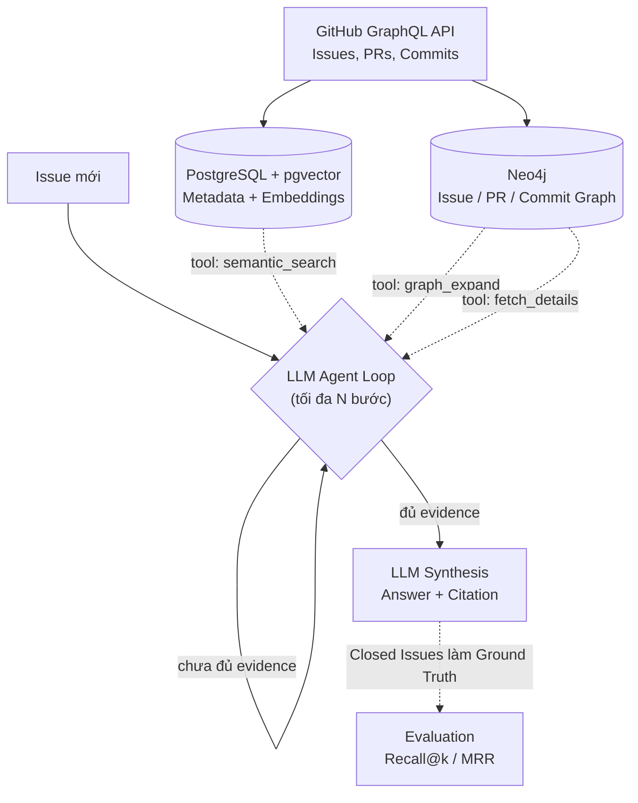

# GitHub Issue Intelligence System

Hệ thống AI Agent hỗ trợ developer điều tra và hiểu một GitHub Issue mới bằng cách **tự quyết định** gọi các tool (semantic retrieval, graph traversal) để thu thập bằng chứng, rồi tổng hợp thành câu trả lời có citation — thay vì phải tự đọc, tìm kiếm và tổng hợp thủ công qua hàng trăm issue/PR/commit cũ.

## 1. Vấn đề thực tế

Khi một Issue mới được tạo, developer/maintainer thường phải:
- Đọc và hiểu nội dung issue
- Tìm kiếm các issue tương tự trong lịch sử repo
- Kiểm tra PR/commit liên quan
- Đọc discussion và tự tổng hợp thông tin trước khi xác định nguyên nhân/hướng xử lý

Quá trình này lặp đi lặp lại, tốn thời gian, và càng khó khi repo có lịch sử lớn — thông tin liên quan nằm rải rác ở nhiều issue, PR, commit khác nhau, thường dùng cách diễn đạt khác nhau cho cùng một vấn đề (nên tìm theo từ khóa không đủ).

**Mục tiêu của dự án**: không thay thế quyết định cuối cùng của developer, mà giảm thời gian tìm kiếm — đọc — tổng hợp, đưa ra bằng chứng (evidence) có căn cứ để developer tự kiểm tra.

## 2. Kiến trúc tổng quan

Khác với một pipeline cố định (luôn chạy retrieval → graph → synthesis theo đúng 1 thứ tự), hệ thống này là một **agent loop**: LLM tự quyết định gọi tool nào, bao nhiêu lần, và khi nào đủ evidence để trả lời — có giới hạn số bước tối đa (step budget) để tránh lặp vô hạn hoặc tốn chi phí không cần thiết.



**Vì sao polyglot persistence (2 loại DB), không phải chọn ngẫu nhiên:**

| DB | Vai trò | Vì sao chọn |
|---|---|---|
| **Postgres + pgvector** | Dữ liệu có cấu trúc + vector embedding cho semantic search | Một nguồn sự thật có cấu trúc, đồng thời làm luôn vector search qua extension `pgvector` — không cần thêm vector DB riêng |
| **Neo4j** | Quan hệ Issue → PR → Commit dưới dạng graph | Quan hệ nhiều tầng là bài toán graph tự nhiên — Cypher truy vấn multi-hop chỉ vài dòng, tự viết bằng SQL sẽ dài và dễ sai |

## 3. Luồng xử lý chi tiết

1. **Ingest**: Gọi GitHub GraphQL API, lấy Issue/PR/Commit cùng các cross-reference **có sẵn** — không tự suy luận liên kết bằng NLP.
2. **Storage**: Transform response từ GitHub và lưu metadata vào PostgreSQL; đồng thời dựng các node/relationship tương ứng trong Neo4j.
3. **Embedding**: Tạo embedding từ nội dung Issue (title + body + comments) và lưu vector vào PostgreSQL với `pgvector`.
4. **Định nghĩa tool cho agent** — 3 tool qua function calling:
   - `semantic_search(query: str, top_k: int)`: tìm issue cũ tương đồng ngữ nghĩa qua `pgvector`
   - `graph_expand(issue_number: int, hops: int)`: từ 1 issue, truy vấn Neo4j lấy PR/commit liên kết
   - `fetch_details(type: str, number: int)`: lấy toàn bộ nội dung 1 issue/PR/commit cụ thể
5. **Agent loop**: LLM nhận issue mới, tự lập kế hoạch — gọi tool nào trước, có cần `semantic_search` lại với query khác nếu kết quả chưa đủ tốt, có cần mở rộng `graph_expand` thêm hop hay không, khi nào dừng để viết câu trả lời. Giới hạn tối đa N bước (step budget) để tránh lặp vô hạn hoặc tốn chi phí không cần thiết.
6. **Log reasoning trace**: ghi lại toàn bộ tool nào được gọi, tham số gì, kết quả gì — dùng để debug và demo, không chỉ nhìn câu trả lời cuối.
7. **Synthesis**: LLM tổng hợp câu trả lời từ evidence đã thu thập, mỗi nhận định kèm link ngược về issue/PR/commit gốc.
8. **Evaluation**: Dùng issue đã đóng trong quá khứ (đã biết PR giải quyết) làm ground truth — giấu đáp án, đo recall@k / MRR khách quan, không chỉ đánh giá bằng mắt.

## 4. Tech stack

- **Data**: GitHub GraphQL API
- **Storage**: PostgreSQL + pgvector (metadata & vector search), Neo4j (graph)
- **Embedding**: sentence-transformer hoặc OpenAI/Anthropic embedding API (chọn cụ thể ở tuần 1)
- **Agent**: function calling (tool use) — tự viết vòng lặp gọi tool, không dùng framework nặng (LangChain/LlamaIndex) cho quy mô project này, để dễ kiểm soát và dễ giải thích khi phỏng vấn
- **Serving**: FastAPI
- **Đánh giá**: recall@k, MRR trên tập issue đã đóng (phần retrieval); kiểm tra thủ công reasoning trace (phần agent/synthesis)

## 5. Kế hoạch 3-4 tuần

| Tuần | Mục tiêu | Đầu ra |
|---|---|---|
| **1** | Chọn repo mục tiêu, dựng ingest pipeline qua GraphQL API, lưu metadata vào PostgreSQL và dựng graph cơ bản trong Neo4j | Data pipeline chạy được, có metadata trong Postgres và node cơ bản trong Neo4j |
| **2** | Thêm embedding + pgvector semantic search; dựng graph model trong Neo4j từ cross-reference có sẵn | Semantic search hoạt động; Cypher query lấy được evidence chain |
| **3** | Định nghĩa tool schema (`semantic_search`, `graph_expand`, `fetch_details`); viết vòng lặp agent với step budget; log reasoning trace; đóng gói FastAPI | Demo end-to-end: nhập issue mới → agent tự gọi tool → nhận câu trả lời kèm nguồn |
| **4** | Xây bộ evaluation (issue đã đóng làm ground truth), đo recall@k/MRR, viết báo cáo kết quả, polish README/demo | Số liệu đánh giá khách quan, sẵn sàng đưa vào CV/portfolio |

## 6. Giới hạn & hướng mở rộng

- MVP giới hạn ở Issue/PR/Commit; **Discussion** để phase sau vì dữ liệu ít chuẩn hóa hơn.
- Liên kết Issue↔PR↔Commit dựa hoàn toàn vào cross-reference GitHub đã có — chưa xử lý trường hợp liên quan ngầm (không có reference rõ ràng) giữa các issue.
- Chỉ ingest issue đã đóng (`states: CLOSED`) vì evidence (`ClosedEvent.closer`) chỉ tồn tại ở nhóm này — hệ thống không phát hiện được các issue trùng lặp mà cả hai đều đang mở.
- Step budget giới hạn tối đa N lần gọi tool/issue — đánh đổi giữa chi phí API và độ đầy đủ evidence; cần tinh chỉnh N qua thực nghiệm.
- Agent có thể chọn sai thứ tự tool hoặc dừng sớm khi evidence chưa đủ — cần log reasoning trace để debug việc này, không chỉ nhìn câu trả lời cuối.
- Chưa có faithfulness check (kiểm tra câu trả lời LLM có bịa thêm chi tiết ngoài evidence hay không) — hướng mở rộng nếu còn thời gian.
- Chưa có RBAC/multi-repo tenant nếu mở rộng thành sản phẩm dùng chung nhiều team.

## 7. Cách chạy (placeholder — cập nhật khi có code)

```bash
docker-compose up -d  # Postgres+pgvector, Neo4j
python -m src.ingest --repo owner/name
python -m src.build_graph
python -m src.build_embeddings
uvicorn src.api:app --reload
```

## Citation / nguồn dữ liệu

Dữ liệu lấy trực tiếp từ GitHub GraphQL API của các repository công khai, tuân theo GitHub Terms of Service — không sử dụng cho mục đích thương mại nếu repo nguồn có giấy phép hạn chế.
